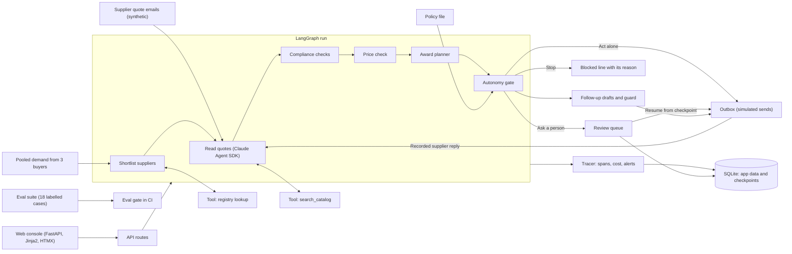

# Pharma RFQ Agent

An agent that runs the quote-to-award step of a pooled medicine RFQ: it reads supplier quotes, checks them, awards low-risk lines alone and sends risky ones to a person.


Full video: https://github.com/ArchiusVuong-sudo/pharma-rfq-agent/releases/download/v0.1/demo.mp4

## What it does

- Takes one pooled RFQ (3 medicines, 3 buyers in Uganda, Kenya and Malawi) and 6 supplier quotes that arrive as messy emails: pasted tables, EUR per 1,000 tablets, a quote with no CoA, a forward whose attachment is missing.
- Click Run agent and watch the timeline: the model reads each email, code runs every compliance and price check on every quote, and each flag names the check that raised it. An unreadable quote is flagged and gets a follow-up, never a guessed number.
- One policy file decides per line: zinc is awarded alone (PO draft and award notice in the outbox), amoxicillin pauses for a person (high value, new supplier, GMP certificate expiring), oxytocin is blocked until documents arrive.
- In the review queue a person approves, rejects or edits the split between suppliers. The paused run resumes from its checkpoint and re-checks the edit; a split under a supplier's MOQ comes back with the reason.
- Supplier follow-ups are drafted by the model and checked by a guard. Simulate reply loads the supplier's answer, a re-check run clears the flags, and because oxytocin is cold chain it opens a new review.
- Runs shows act-alone, review and blocked rates, latency, cost and alerts; each run has a trace waterfall. Evals scores 18 labelled cases and fails when a risky quote would be awarded with no person in the loop.

## Architecture



## How it works

The design line: the model reads and writes, code decides money and compliance.

**The run.** A LangGraph `StateGraph` with ten nodes: shortlist, read quotes, compliance, price, plan, gate, follow-ups, act alone, human review, finish. Each run is one thread in a SQLite checkpointer (`AsyncSqliteSaver`), so a paused run survives a server restart.

**Reading quotes.** Each email goes to Claude through the Agent SDK with one tool, `search_catalog` (fuzzy match over names, synonyms and strength), and a JSON schema built from the Pydantic `ExtractedQuote` model. The prompt says to copy values as written and leave anything unstated null. The output is validated again in Pydantic; a failure is retried once with the error, then the quote is marked unreadable and an alert fires. Emails are read concurrently, four at a time.

**Checks in code.** Every quote item goes through the registry, GMP expiry, country registration, documents (CoA, 2-8 C storage for cold-chain products, shelf life, lead time), shelf life left on arrival, lead time against the needed-by date, and landed price against a synthetic reference. Each flag has a severity: block (cannot be used), hold (waits on the supplier, gets a follow-up), review (usable, needs a person) or info.

**Award planner.** Each buyer's demand goes to compliant suppliers registered in that buyer's country, cheapest landed unit cost first, within capacity. Landed cost uses fixed FX rates and Incoterm uplifts (demo assumptions in the policy). A supplier whose pooled total ends up under its MOQ is dropped and its share moves to the next one. The same validator re-checks a reviewer's edited split.

**Autonomy gate.** `policy.yaml` lists the line rules (no supply, partial supply, value limit, new supplier, cold chain, price outlier, GMP expiring, late delivery) and the route each one forces. The strictest route wins, and every decision lists the rules that fired with the reason. Review lines call LangGraph `interrupt()`; the review queue resumes them with `Command(resume=...)`.

**Follow-ups.** The model drafts the email. A guard checks it names every missing item, mentions no price or amount, promises no award or order, and stays under 120 words. One redraft with the guard's feedback, then a fixed template. If the model is down, the template goes out and an alert fires.

**Sandboxed model calls.** Every SDK query runs with no built-in Claude Code tools (`tools=[]`), only this app's tool through an in-process MCP server, `setting_sources=[]`, strict MCP config, no session persistence, a fresh temp working directory, a turn cap, a budget cap, permission mode `dontAsk` plus a deny-all permission callback, and a child environment built from an allowlist (a small wrapper drops every other variable before the CLI starts). Calls retry with backoff on overload, rate limits and 5xx errors.

**Tracing and alerts.** Node, LLM and tool spans go to SQLite with latency, model, tokens and API-equivalent cost (as reported by the SDK, not a bill). Alerts fire on schema retries, tool errors, follow-up template fallbacks, runs over the cost or latency budget, and reviews pending past the SLA. `FAULT_ONCE=registry_timeout` makes the first registry lookup time out so you can see the retry and the alert.

**Evals.** 18 labelled synthetic cases: the 6 demo emails plus cases for each policy rule, three of them stopped only by the price-outlier rule (known supplier, under the value limit, valid documents, no cold chain, price far from reference). The suite scores extraction field accuracy, flag recall, routing accuracy and unsafe auto-approvals. The gate fails on any unsafe auto-approval, on any case error, or on routing accuracy under 90%. Switch the price-outlier rule off and it fails on 3 cases.

**Replay mode.** One provider interface with two implementations. Live calls the SDK; replay answers from `fixtures/llm/`, responses recorded from real live runs by `scripts/record_fixtures.py`, keyed by a hash of the exact request. Replay re-runs the recorded tool calls against today's tools so traces still show real tool spans. The app uses live when it finds a login or key, replay otherwise, and shows a Replay mode badge.

Trade-offs, briefly: structured output plus a validator is simpler to reason about than a free-form tool loop, at the cost of one extra call when the schema check fails. The planner is greedy, not an optimiser: easy to explain to a reviewer, and the human step catches the cases where a split by hand is better. Fixtures keyed by request hash break loudly when a prompt changes, which is the point; re-record them with one command.

## Run it

Needs Python 3.12 and [uv](https://docs.astral.sh/uv/).

```bash
uv sync

# Replay mode: recorded model outputs, no login or key needed
DEMO_REPLAY=1 uv run python -m rfq_agent.web
# open http://127.0.0.1:4103

# Live mode: Claude Agent SDK on your Claude Code login (or set ANTHROPIC_API_KEY)
LLM_MODE=live uv run python -m rfq_agent.web

# Live, with an injected tool fault to see the retry and the alert
LLM_MODE=live FAULT_ONCE=registry_timeout uv run python -m rfq_agent.web

# Eval gate on recorded outputs (exit 1 when it fails)
uv run python -m rfq_agent.evals --gate
uv run python -m rfq_agent.evals --gate --disable price_outlier

# Re-record every model response from live runs (after changing a prompt or seed email)
uv run python scripts/record_fixtures.py
```

Environment variables (see `.env.example`):

| Variable | Default | What it does |
| --- | --- | --- |
| `LLM_MODE` | `auto` | `live`, `replay` or `auto` (live when a login or key is found) |
| `DEMO_REPLAY` | unset | `1` forces replay mode |
| `RFQ_MODEL` | `claude-sonnet-5-5` | model for live runs (`claude-opus-5-5` and `claude-haiku-5-5` also work) |
| `ANTHROPIC_API_KEY` | unset | use an API key instead of the local Claude Code login |
| `HOST`, `PORT` | `127.0.0.1`, `4103` | where the console listens |
| `RFQ_DATA_DIR` | `./data` | app data and LangGraph checkpoints (two SQLite files) |
| `REPLAY_DELAY_SCALE` | `0.35` | share of the recorded latency replay waits, so the timeline streams |
| `FAULT_ONCE` | unset | `registry_timeout` injects one tool timeout |

## Tests

```bash
uv run pytest            # replay mode, no network
LIVE=1 uv run pytest tests/test_live_smoke.py   # one real model call
uv run ruff check src tests scripts && uv run mypy
```

They cover every check, pricing and its missing-data paths, catalog search, the planner (capacity, MOQ, unmet demand) and the edit validator, every gate rule and switching a guardrail off, the follow-up guard with its redraft and template fallbacks, the registry fault and retry, the sandboxed SDK options and the child environment allowlist, schema retries, record and replay, the service flows (award run, bad and good edits, reject, resume after a restart from the checkpoint, supplier reply and re-check, SLA alerts), the eval gate and its CLI exit codes, and one end-to-end walk through the web app. CI runs lint, types, tests and the eval gate in replay mode.

## Notes

- All data is synthetic: buyers, suppliers, people, certificates (`SYN-` numbers), prices, reference prices, FX rates and Incoterm uplifts are invented. Policy values are demo settings, not regulatory guidance. Sends are simulated into the outbox.
- In one live award run on this setup the agent made 8 model calls with about 17 s of active time and about $0.06 API-equivalent cost. Live runs vary; replay numbers in the UI come from the recorded runs.
- Limits: one RFQ, fixed FX rates, a greedy planner, no attachments (a missing attachment becomes a follow-up), and a single reviewer with no roles.
- A production version would add: attachment and PDF reading with page-level citations, live FX and freight rates, reviewer roles with four-eyes approval above a second limit, real email and ERP integrations behind an outbox worker with idempotent sends, and online evals on sampled production quotes with drift alerts.
